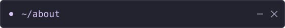
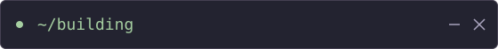
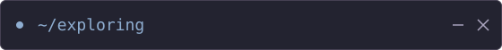
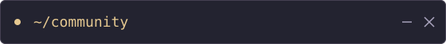
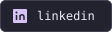
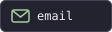

<table width="100%">
  <tr>
    <td width="50%" valign="top">
      
        
      <samp>
        <b>Systems Engineering student @ UNSA</b>  
        Based in Peru. Building across backend, web, and mobile.  
        Linux user. Curious about how things work.
      </samp>
        
    </td>
    <td width="50%" valign="top">
      
        
      <samp>
        <b>QuantumHub Peru</b> 
        Frontend Lead / Innovation Committee  
        Developing the platform, one component at a time.  
        [ status: in development ]
      </samp>
        
    </td>
  </tr>
  <tr>
    <td width="50%" valign="top">
      
        
      <samp>
        &gt; Quantum computing &amp; Qiskit  
        &gt; Computational geometry  
        &gt; Algorithms &amp; problem solving  
        <i>There's always another question.</i>
      </samp>
        
    </td>
    <td width="50%" valign="top">
      
        
      <samp>
        &gt; ACM UNSA  
        &gt; QuantumHub Peru  
        &gt; IEEE CS PUCP 
        &nbsp; Technical Committee  
        <i>Learning is better with company.</i>
      </samp>
        
    </td>
  </tr>
</table>

 

<table width="100%">
  <tr>
    <th colspan="3" align="left"><samp>$ ls ~/toolbox</samp></th>
  </tr>
  <tr>
    <td width="33%" align="center" valign="top">
      <samp><b>languages</b></samp>  
      
      
       
      
      
      
        
    </td>
    <td width="33%" align="center" valign="top">
      <samp><b>web &amp; mobile</b></samp>  
      
       
      
        
    </td>
    <td width="34%" align="center" valign="top">
      <samp><b>backend &amp; environment</b></samp>  
      
       
      
      
      
        
    </td>
  </tr>
</table>

   
  <samp>
    
    &nbsp;&nbsp;
    
      
    
  </samp>

